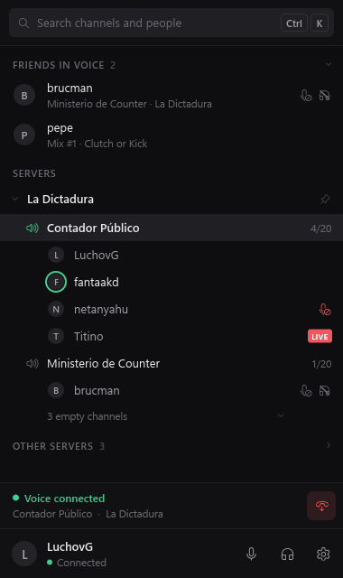
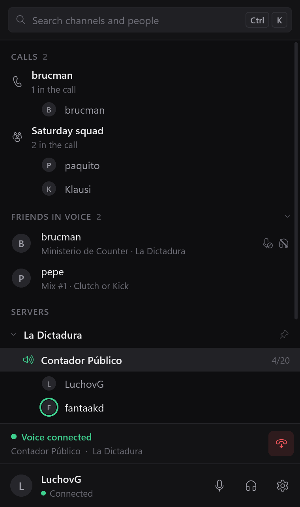
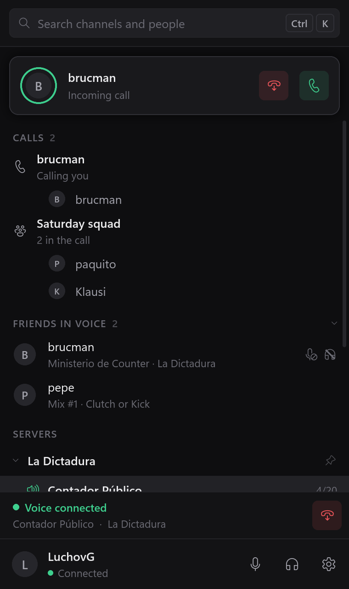
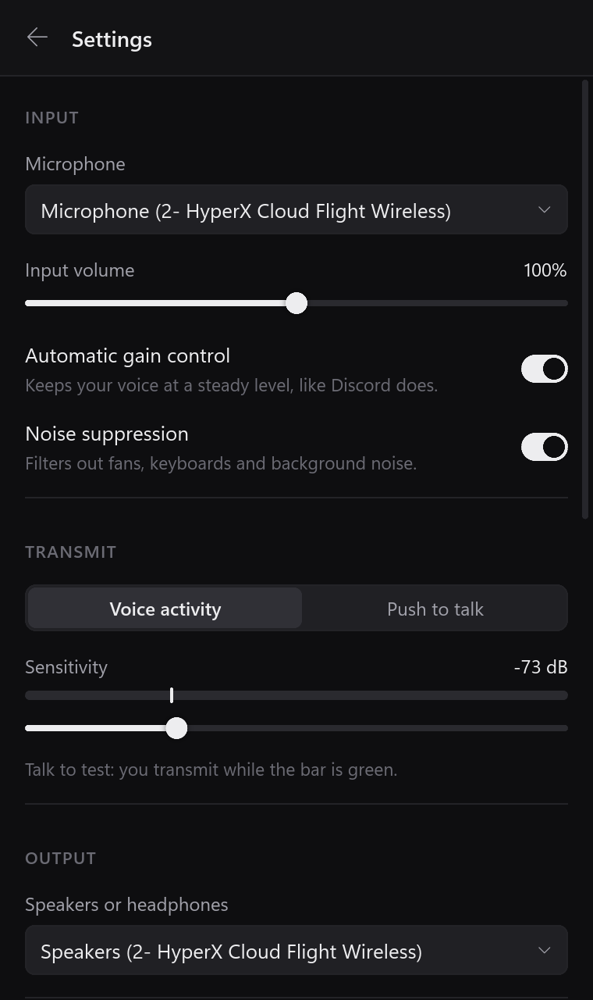

<p align="center">
  
</p>

<h1 align="center">bardo</h1>

<p align="center">
  A small Discord client for Windows that only does voice.
</p>

<p align="center">
  <a href="https://github.com/luchoov/bardo/releases/latest/download/bardo-setup.exe"><b>Download the installer</b></a>
  &nbsp;·&nbsp;
  <a href="https://github.com/luchoov/bardo/releases/latest/download/bardo.exe">Portable exe</a>
  &nbsp;·&nbsp;
  <a href="https://github.com/luchoov/bardo/releases">All releases</a>
</p>

<p align="center">
  <a href="https://github.com/luchoov/bardo/actions/workflows/ci.yml"></a>
  <a href="https://github.com/luchoov/bardo/releases/latest"></a>
  <a href="LICENSE"></a>
</p>

<p align="center">
  
</p>

The Discord app is a whole browser. If all you use it for is talking with friends while you play,
that is a lot of memory and CPU for a voice call. bardo is a native client that does voice channels
and calls, and nothing else.

## What it does

<p>
  
  
  
</p>

- Shows your servers' voice channels and who is in each, live, with friends in voice at the top.
- Joins a channel with one click. `Ctrl+K` searches every channel and everyone in voice.
- Push-to-talk or voice activity, with noise suppression and automatic gain control.
- Mute and deafen hotkeys that work in game, without taking the keys away from it.
- Per-user volume up to 200 % and local mute. Server mute, deafen, move and disconnect when you
  have the permissions.
- DM and group calls: call, answer, decline.
- Lives in the tray and can start with Windows. Short, quiet sounds for joins, leaves, mute and
  deafen.
- Voice is end-to-end encrypted (DAVE), like in the official client.

## bardo and Discord side by side

Both signed in to the same account on the same PC, idle and not in a call, for three minutes:

| | bardo 0.1.0 | Discord 1.0.9262 |
|---|---|---|
| Memory | 23 MB | 374 MB |
| CPU | 0.0 % | 1.1 % |
| Processes | 1 | 6 |
| On disk | 29 MB | 450 MB |

Memory is the private working set, the "Memory" column in Task Manager, added up over every
process. CPU is the share of the whole machine, an Intel Core i7-7700 on Windows 11. Both windows
were open. [tools/bench.ps1](tools/bench.ps1) measures both on your own PC while you use them.

## What it doesn't do

No text chat, video, screen sharing, soundboard or Stage channels. There is no echo cancellation,
so use headphones. Windows 10 and 11, 64-bit only.

You can keep the official client for text and close it while you play.

## Before you use it

bardo is not made by or affiliated with Discord. Logging in from an unofficial client is against
Discord's Terms of Service, and Discord could ban the account. Use it knowing that.

It signs in with your account's token. [This guide](docs/token.md) shows how to get it. The token
is kept in Windows Credential Manager and only sent to Discord. Besides Discord, bardo makes one
request per start to GitHub, to see whether there is a newer version.

The exe is not code-signed, so the first time you run it Windows SmartScreen warns about it: click
"More info" and then "Run anyway". Some antivirus programs may flag it too, because it reads the
keyboard state for push-to-talk and the hotkeys, stores a token and connects to the internet. It
only checks the keys you bound. You can read the source and build it yourself.

## Install

- **Installer** (`bardo-setup.exe`): installs for your user only, no admin rights needed. Adds bardo
  to the Start menu, and you can remove it from Settings → Apps.
- **Portable** (`bardo.exe`): a single file that runs from anywhere. If you turn on "Start with
  Windows" and then move the file, turn it on again.

bardo tells you when a new version is out. Settings are in `%APPDATA%\bardo`.

## Bug reports

bardo writes a log to `%LOCALAPPDATA%\bardo\bardo.log` (Settings → Logs → Open folder). Attach it
to the [issue](https://github.com/luchoov/bardo/issues). It never contains your token, but it does
contain server, channel and user ids.

## Building

Rust stable (MSVC), Visual Studio Build Tools with C++ and the Windows SDK, and CMake, then:

```
cargo build --release -p bardo
```

[docs/development.md](docs/development.md) covers the layout, the stack, the demo mode and how
releases are made.

## License

[MIT](LICENSE)
