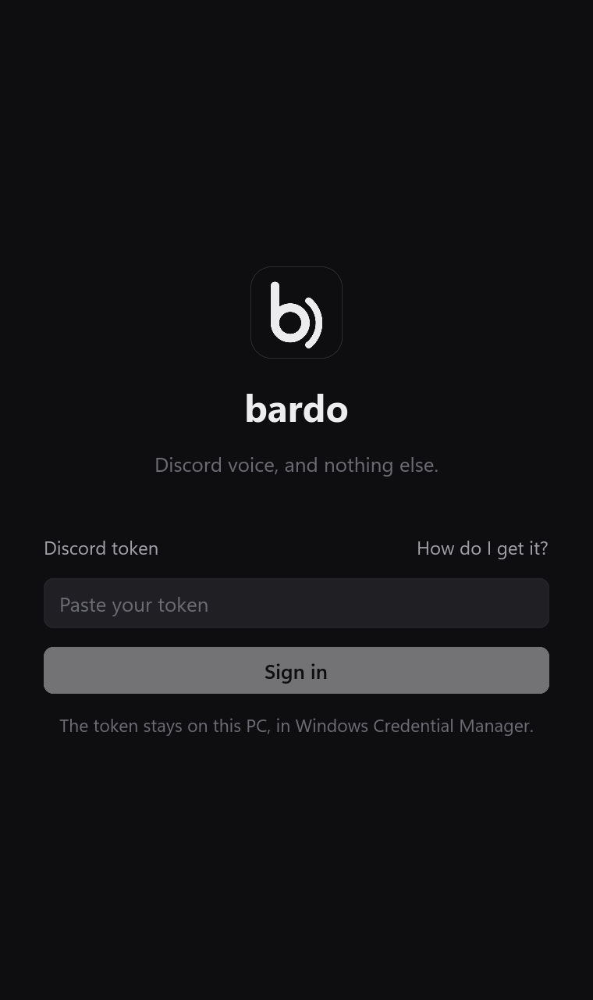
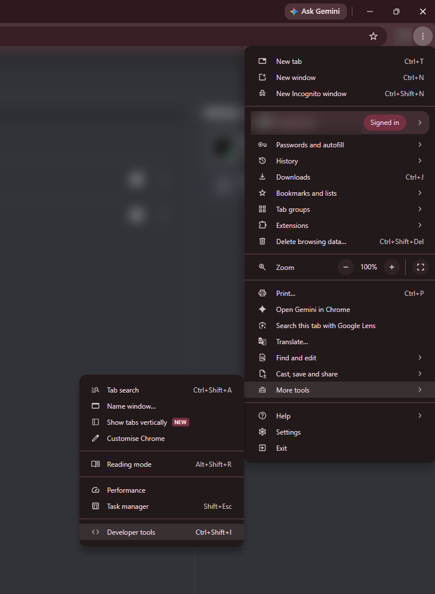
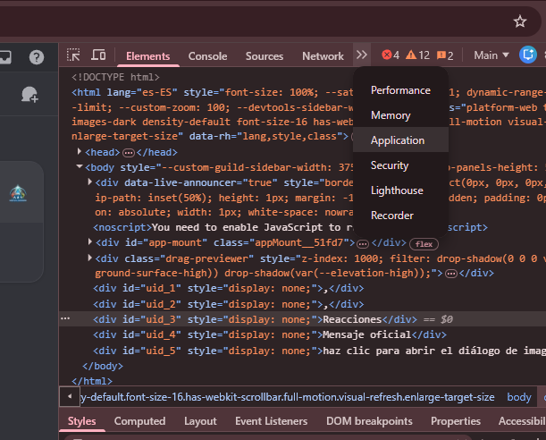
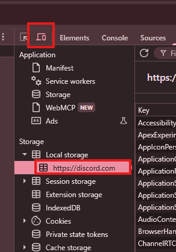
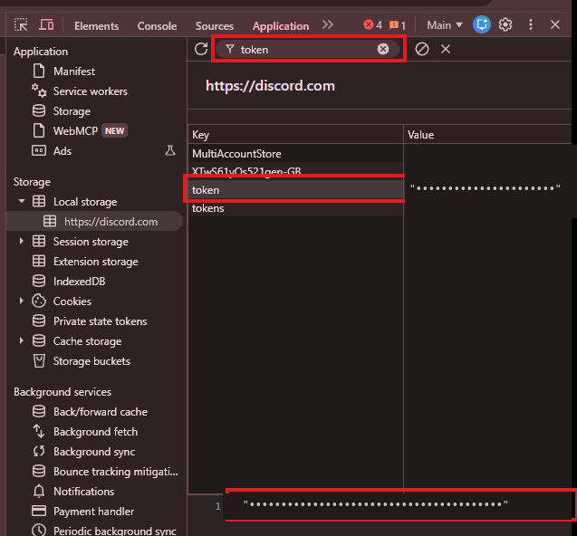

# Getting your Discord token

bardo signs in with your account's token, the same key the Discord app keeps after you log in.
You copy it once from Discord in the browser; bardo stores it in Windows Credential Manager.

**Treat the token like your password.** Anyone who has it is logged in as you, with no password and
no 2FA. Paste it into bardo and nowhere else, and never paste code into the browser console because
someone told you to: that is how accounts get stolen.

These steps are for Chrome or Edge. Firefox has the same panels under slightly different names.

## 1. Open the developer tools

Go to [discord.com/app](https://discord.com/app) and log in. Then open the browser menu →
**More tools** → **Developer tools**, or press `Ctrl+Shift+I`.

## 2. Open the Application tab

It may be hidden behind `»` at the end of the tab row.

## 3. Switch to the mobile view and reload

Discord removes the token from the page's storage once it loads, except in the mobile layout.
Click the device toolbar button (or press `Ctrl+Shift+M`), then reload the page with `F5`.
In the sidebar, open **Local storage** → **https://discord.com**.

## 4. Copy the token

Type `token` in the filter box and click the `token` row. Its value shows at the bottom: copy it
and paste it into bardo. The quotes around it can stay; bardo removes them.

You can close the developer tools and turn the device toolbar off again afterwards.

## Good to know

- **The token stops working when you log out of that browser session or change your password.**
  If bardo says Discord rejected the token, get a new one the same way.
- If someone else might have seen your token, change your Discord password: that invalidates it.
- To remove it from this PC, use **Sign out** in bardo's settings, or delete `bardo` /
  `discord-token` in Windows Credential Manager.
- Using a user account from an unofficial client is against Discord's Terms of Service. See the
  [README](../README.md#before-you-use-it).

### Another way

In the **Network** tab of the developer tools, click any request to `discord.com/api` and copy the
value of its `Authorization` request header. It is the same token.
